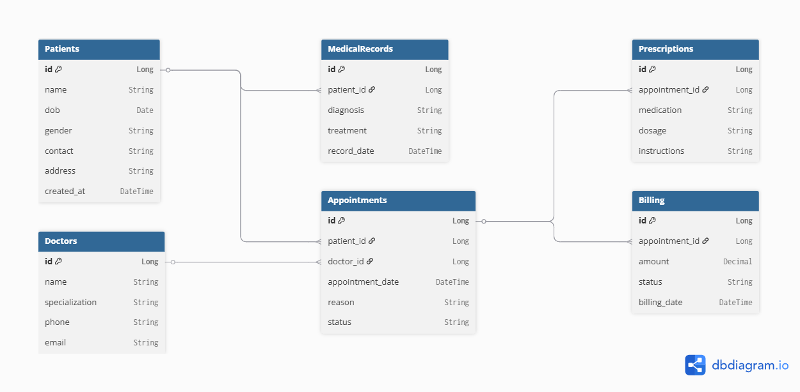

# Healthcare REST API

A Spring Boot REST API with a **MySQL** database for a healthcare management system. It supports hospital front-desk systems, doctor dashboards and patient portals.

## Business Context
- **Patients** can register, update their profiles and view medical history.
- **Doctors** can manage their schedules and view patient appointments.
- **Appointments** are scheduled between patients and doctors.
- **Prescriptions** are issued per appointment and stored for future reference.
- **Medical records** track diagnoses and treatments over time.
- **Billing** tracks payments and charges for each appointment.

## Tech Stack
Java 17 · Spring Boot 3.2 (Web, Data JPA) · MySQL 8 · Maven

## Database Design


| Relationship | Type |
|---|---|
| Patients -> Appointments | One-to-Many |
| Doctors -> Appointments | One-to-Many |
| Appointments -> Prescriptions | One-to-One |
| Patients -> MedicalRecords | One-to-Many |
| Appointments -> Billing | One-to-One |

Tables: `patients`, `doctors`, `appointments`, `prescriptions`, `medical_records`, `billing`.

## Project Structure
```
healthcare-api/
├── pom.xml
├── sql/
│   ├── schema.sql          # tables + foreign keys
│   └── sample-data.sql     # optional test data
├── docs/er-diagram.png
└── src/main/
    ├── java/com/healthcare/
    │   ├── HealthcareApplication.java
    │   ├── controller/     # REST endpoints
    │   ├── service/        # business rules
    │   ├── repository/     # Spring Data JPA
    │   ├── entity/         # Patient, Doctor, Appointment, Prescription, MedicalRecord, Billing
    │   └── exception/      # JSON error handling
    └── resources/application.properties
```

## Setup
1. Install Java 17+, Maven and MySQL 8.
2. Create the database and tables:
   ```bash
   mysql -u root -p < sql/schema.sql
   mysql -u root -p < sql/sample-data.sql    # optional
   ```
3. Set your MySQL username/password in `src/main/resources/application.properties`.
4. Run:
   ```bash
   mvn spring-boot:run
   ```
   The API starts at `http://localhost:8080`.

## API Endpoints

| Resource | Method | Endpoint | Description |
|---|---|---|---|
| Patients | POST | `/api/patients` | Create new patient |
| | GET | `/api/patients` | List all patients |
| | GET | `/api/patients/{id}` | Get patient by ID |
| | PUT | `/api/patients/{id}` | Update patient |
| | DELETE | `/api/patients/{id}` | Delete patient |
| Doctors | POST | `/api/doctors` | Create new doctor |
| | GET | `/api/doctors` | List all doctors |
| | GET | `/api/doctors/{id}` | Get doctor by ID |
| | PUT | `/api/doctors/{id}` | Update doctor |
| | DELETE | `/api/doctors/{id}` | Delete doctor |
| Appointments | POST | `/api/appointments` | Schedule new appointment |
| | GET | `/api/appointments` | List all appointments |
| | GET | `/api/appointments/{id}` | Get appointment by ID |
| | PUT | `/api/appointments/{id}` | Update appointment |
| | DELETE | `/api/appointments/{id}` | Cancel appointment |
| Prescriptions | POST | `/api/prescriptions` | Add prescription |
| | GET | `/api/prescriptions` | List all prescriptions |
| | GET | `/api/prescriptions/{id}` | Get prescription by ID |
| | PUT | `/api/prescriptions/{id}` | Update prescription |
| | DELETE | `/api/prescriptions/{id}` | Delete prescription |
| Medical Records | POST | `/api/records` | Add medical record |
| | GET | `/api/records` | List all records |
| | GET | `/api/records/{id}` | Get record by ID |
| | PUT | `/api/records/{id}` | Update record |
| | DELETE | `/api/records/{id}` | Delete record |
| Billing | POST | `/api/billing` | Create billing entry |
| | GET | `/api/billing` | List all billing entries |
| | GET | `/api/billing/{id}` | Get billing by ID |
| | PUT | `/api/billing/{id}` | Update billing |
| | DELETE | `/api/billing/{id}` | Delete billing |

Optional filters on list endpoints (supports "view medical history" and "doctor's appointments"):
`GET /api/appointments?patientId=1`, `GET /api/appointments?doctorId=1`, `GET /api/records?patientId=1`

## Sample Requests
```bash
# Create patient
curl -X POST localhost:8080/api/patients -H "Content-Type: application/json" \
  -d '{"name":"Ravi Kumar","dob":"1990-05-14","gender":"Male","contact":"9876543210","address":"Kurnool"}'

# Create doctor
curl -X POST localhost:8080/api/doctors -H "Content-Type: application/json" \
  -d '{"name":"Dr. Suresh Reddy","specialization":"Cardiology","phone":"9988776655","email":"suresh@hospital.com"}'

# Schedule appointment
curl -X POST localhost:8080/api/appointments -H "Content-Type: application/json" \
  -d '{"patientId":1,"doctorId":1,"appointmentDate":"2026-11-20T10:30:00","reason":"Checkup"}'

# Add prescription (one per appointment)
curl -X POST localhost:8080/api/prescriptions -H "Content-Type: application/json" \
  -d '{"appointmentId":1,"medication":"Aspirin","dosage":"75 mg","instructions":"After breakfast"}'

# Add medical record
curl -X POST localhost:8080/api/records -H "Content-Type: application/json" \
  -d '{"patientId":1,"diagnosis":"Hypertension","treatment":"Medication"}'

# Create billing entry (one per appointment)
curl -X POST localhost:8080/api/billing -H "Content-Type: application/json" \
  -d '{"appointmentId":1,"amount":1500.00,"status":"PENDING"}'
```

## Rules & Error Responses
- Appointments need a valid `patientId` and `doctorId`; prescriptions/billing need a valid `appointmentId`; records need a valid `patientId` -> `400`.
- Only one prescription and one billing entry per appointment -> `409`.
- A patient/doctor with appointments (or a patient with records) cannot be deleted, nor an appointment that has a prescription or billing entry -> `409`.
- Unknown ID -> `404`. Delete returns `204`, create returns `201`.
- Defaults: appointment status `SCHEDULED`, billing status `PENDING`, dates default to the current time.

## Push to GitHub
```bash
cd healthcare-api
git init
git add .
git commit -m "Initial commit: Healthcare REST API"
git branch -M main
git remote add origin https://github.com/<your-username>/healthcare-api.git
git push -u origin main
```
